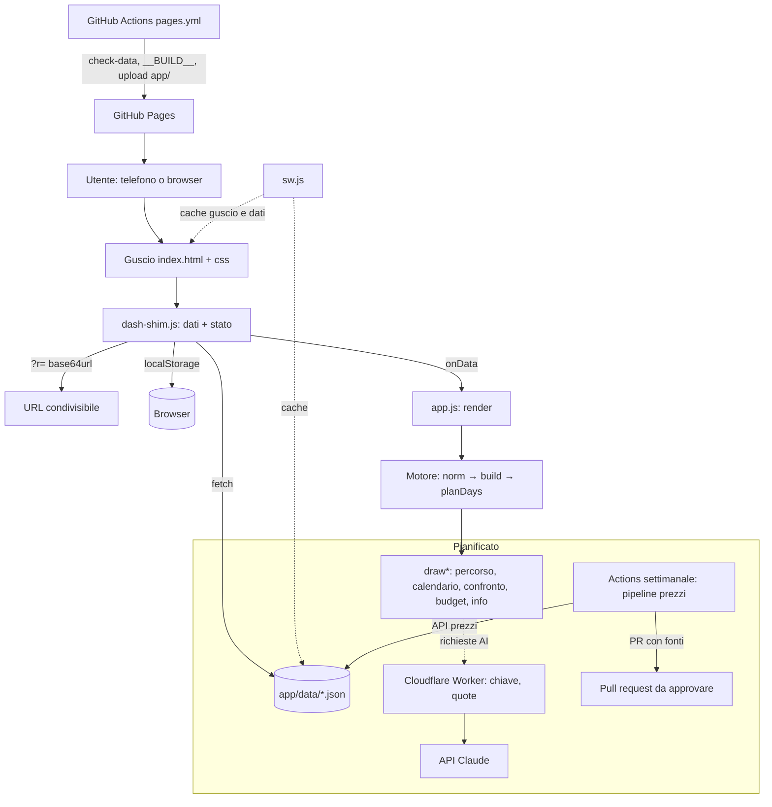

# Architettura — Japan Tour Planner

**Versione:** 0.4.0
**Ultima modifica:** 2026-10-30
**Autore:** Giacomo Del Prato
**Stato:** Approvato (riflette il sistema reale; le parti pianificate sono marcate come tali)

---

## Panoramica

Japan Tour Planner è una web app che costruisce un viaggio in Giappone a partire da poche scelte: mete, notti, numero di viaggiatori, città di partenza, aeroporti di arrivo e ritorno con orario dei voli, bagagli, stile di viaggio. Calcola in quali città dormire e per quante notti, l'ordine delle tappe con meno ore di treno, il programma giorno per giorno con feste, ciliegi e foliage, un confronto tra percorsi e un budget per categoria. È pensata per chi organizza il proprio viaggio, gratis, senza registrarsi, condividendo il risultato con un link.

Archetipo secondo la matrice di applicabilità degli standard: oggi **software deterministico senza componenti AI**. Il piano (`PIANO_DI_SVILUPPO.md` §6) lo porta a **GenAI** (assistente con output strutturato, nessun tool con effetti) e include un componente **agentico** separato, l'agente dati che apre pull request: a quello si applicano S18–S23 (vedere `tools-registry.md`, `agent-perimeter.md`).

---

## Contesto e vincoli

- **Nessun costo fisso e nessun account.** L'app è statica, pubblicata su GitHub Pages, senza backend e senza database. Lo stato vive nel link e nel browser dell'utente.
- **Offline.** Un service worker serve guscio e dati dalla cache: l'app deve funzionare in treno e in aereo.
- **Nessun build step.** HTML, CSS e JavaScript vanilla, una sola libreria (D3) inclusa nel repository. Si aggiungono strumenti di sviluppo (lint, test, validazione) ma il deploy copia i file così come sono (ADR-001).
- **Determinismo.** Lo stesso input produce lo stesso risultato; nessun dato esterno entra nel calcolo. L'AI, quando arriverà, produce parametri e testi, mai numeri (ADR-003).
- **Retrocompatibilità dei link.** Un link `?r=` condiviso mesi fa deve aprirsi con lo stesso percorso: i parametri mancanti vengono completati con default.
- **Lingua italiana** per interfaccia, dati, codice e documentazione.

---

## Componenti principali

| Componente | Responsabilità | Tecnologia |
|---|---|---|
| Guscio (`app/index.html`, `app/css/`) | Struttura della pagina, cinque schede, pannello "Il viaggio", tema chiaro/scuro | HTML, CSS con token `--cds-*` |
| Runtime dati e stato (`app/js/dash-shim.js`) | Carica i dataset da `app/data/`, tiene i parametri del viaggio, li persiste nell'URL (`?r=` base64url) e in `localStorage`, registra il service worker, mostra la barra "Aggiorna" | JavaScript, espone `window.dash` |
| Motore (`app/js/app.js`: `norm`, `build`, `planDays`, `shortest`, `order`) | Dai parametri calcola basi, notti, ordine, giornate, costi | JavaScript puro, D3 solo per somme |
| Interfaccia (`app/js/app.js`: `render`, `draw*`) | Disegna picker, KPI, mappa, linea, tappe, calendario, confronto, budget, info | DOM diretto, D3 per mappa e zoom |
| Dati (`app/data/*.json`) | Catalogo mete, basi, tratte, parametri di costo, partenze, eventi, stagioni, modelli di viaggio, geometria della mappa | JSON versionato, validato da `scripts/check-data.mjs` |
| Service worker (`app/sw.js`) | Guscio dalla cache della versione installata; dati con rete prima e cache dopo 3 s | Cache API; nome cache con il commit (`__BUILD__`) |
| Pubblicazione (`.github/workflows/pages.yml`) | Valida i dati, sostituisce `__BUILD__`, pubblica `app/` su GitHub Pages | GitHub Actions |
| Controlli (`.github/workflows/ci.yml`, `Makefile`) | Lint, validazione dati, unit test, smoke test nel browser su ogni PR | ESLint, Prettier, `node --test`, Playwright |
| *Pianificato:* proxy serverless (`worker/`) | Chiamate ai modelli con chiave custodita, quote per IP, CORS sull'origine dell'app | Cloudflare Worker (ADR-004) |
| *Pianificato:* pipeline dei prezzi (`scripts/`, Actions) | Aggiorna `app/data/prezzi/` da API e, via PR, i valori ricavati con AI | Node, GitHub Actions |

---

## Diagramma architetturale

---

## Flussi principali

### Flusso 1 — Avvio e calcolo

1. `index.html` carica `dash-shim.js`, `d3`, `app.js`.
2. `dash-shim.js` legge `params.json` (default), poi i parametri da `?r=` se presente, altrimenti da `localStorage`; carica in parallelo tutti i dataset di `DATASETS` e richiama i callback.
3. `app.js` costruisce `D` (mappa dei dataset) e chiama `render()`: `norm()` completa i parametri, `build()` produce `R`, la scheda attiva viene disegnata.
4. Ogni interazione chiama `dash.setParams()`: merge, salvataggio, riscrittura dell'URL, nuovo `render()`.

### Flusso 2 — Costruzione del percorso (`build`)

1. Dalle mete selezionate si ricavano le basi: città in cui si dorme, gite assegnate alla base più vicina tra quelle presenti, pernottamenti sul posto (`pernotto`), città visitate in giornata (`giornata_citta`).
2. Ogni base riceve le notti minime in base alle mezze giornate necessarie e all'ora di arrivo; le notti in più vanno a chi ne ha avute meno rispetto a quanto c'è da fare, fino a `max_notti` per base.
3. `order()` sceglie l'ordine con meno ore di treno (programmazione dinamica sui sottoinsiemi, fino a 12 basi): la prima base è la città di arrivo, l'ultima tratta porta all'aeroporto di ritorno.
4. Si calcolano treni, gite, alloggi (stile, numero di persone, ryokan), voli (città di partenza, alta stagione, open-jaw), cibo, ingressi, trasporti locali, assicurazione, eSIM, Takkyubin: ogni categoria con min e max a persona.

### Flusso 3 — Condivisione

1. "Copia link" fissa la data di partenza se non era stata scelta e scrive `?r=` con tutti i parametri.
2. Chi apre il link vede lo stesso viaggio; le modifiche restano nel suo browser finché non condivide a sua volta.

### Flusso 4 — Aggiornamento dell'app installata

1. Un push su `main` pubblica una nuova versione con un nuovo nome di cache.
2. Il service worker nuovo si installa, prende il controllo e `dash-shim.js` mostra "È disponibile una nuova versione": l'utente decide quando ricaricare.
3. I dati in `app/data/` si aggiornano anche senza nuova versione, appena c'è rete.

---

## Integrazioni esterne

| Sistema | Tipo di integrazione | Protocollo | Note |
|---|---|---|---|
| GitHub Pages | Hosting statico | Deploy da Actions | Unica dipendenza esterna oggi |
| Google Fonts | Font dell'interfaccia | CSS esterno | Se offline, fallback ai font di sistema |
| *Pianificato:* API Claude via Worker | Assistente, revisione, lettura prenotazioni | HTTPS JSON | Chiave nel segreto del Worker, quote, cache dei prompt (ADR-004) |
| *Pianificato:* frankfurter.app (BCE) | Cambio yen/euro | HTTPS, senza chiave | Fallback al valore in `parametri.json` |
| *Pianificato:* Rakuten Travel, Travelpayouts o Amadeus | Prezzi hotel e voli | HTTPS con chiave, solo da Actions | Mai dal browser |
| *Pianificato:* Open-Meteo, Nager.Date | Meteo, festività | HTTPS, senza chiave | Cache nel service worker |

---

## Decisioni architetturali rilevanti

| Decisione | ADR | Motivazione sintetica |
|---|---|---|
| Standard della practice adattati a una web app statica | [ADR-001](decisions/ADR-001-standard-adattati-a-web-app-statica.md) | Stack JavaScript senza build; equivalenti dichiarati per ogni artefatto Python |
| L'app servita vive in `app/`, il resto del repository non viene pubblicato | [ADR-002](decisions/ADR-002-app-in-cartella-dedicata.md) | Separare sito pubblicato da documentazione, test e tooling |
| Motore deterministico, AI come interfaccia | [ADR-003](decisions/ADR-003-motore-deterministico-ai-come-interfaccia.md) | Risultati verificabili, riproducibili, offline |
| Proxy serverless per le chiamate ai modelli | [ADR-004](decisions/ADR-004-proxy-serverless-per-i-modelli.md) | Chiavi mai nel browser, costi sotto controllo, nessun account |
| Trunk-based: `main` più feature branch con PR, senza `develop` | [ADR-005](decisions/ADR-005-branch-strategy-trunk-based.md) | Un solo sviluppatore, deploy continuo da `main` |

---

## Failure modes e gestione

| Failure | Probabilità | Impatto | Gestione |
|---|---|---|---|
| JSON non valido o incoerente pubblicato | Bassa (dopo `check-data`) | Alto: "Impossibile caricare i dati" | `scripts/check-data.mjs` blocca deploy e commit; il service worker serve l'ultima copia buona finché il nuovo file non risponde 200 |
| Rete assente | Alta in viaggio | Nessuno se già aperta una volta | Guscio e dati dalla cache; dati con timeout 3 s |
| Versione nuova con file vecchi in cache | Media | Medio: errori in console | Cache con nome del commit, `cache: 'reload'` all'installazione, navigazioni servite sempre da `index.html` |
| Link `?r=` con parametri di una versione precedente | Alta nel tempo | Medio | `norm()` completa e sana tutto; test di retrocompatibilità in `tests/integration/` |
| Tratta mancante tra due basi | Bassa | Alto: `shortest` restituisce `null`, costo 99 ore | `check-data` verifica che ogni base sia raggiungibile dagli aeroporti |
| Google Fonts non raggiungibile | Media | Basso | Font di sistema di riserva nel CSS |
| *Pianificato:* Worker o API dei modelli non disponibili | Media | Basso | Ogni funzione AI ha un equivalente senza rete (wizard, regole deterministiche) |

---

## Considerazioni di sicurezza

- **Nessun segreto nel repository né nel browser.** Oggi non esistono chiavi. Quelle future (API dei modelli, API prezzi) stanno nei segreti di GitHub Actions e del Worker; `.env.example` le documenta senza valori; `scan_secrets.py` e `detect-private-key` controllano ogni scrittura e commit.
- **Dati personali.** L'app non raccoglie identità: i parametri del viaggio (date, numero di persone, mete) stanno nel link e nel dispositivo dell'utente. Il proxy pianificato riceve solo parametri e domanda, senza identificativi, e non conserva nulla.
- **Contenuti dinamici.** Il DOM è costruito con `textContent`, mai con `innerHTML` su dati: i JSON e il contenuto di `?r=` non possono iniettare markup.
- **Superficie esposta.** Solo file statici su GitHub Pages; con il Worker si aggiungono endpoint POST con CORS limitato all'origine dell'app, schema di richiesta validato, quote per IP e totali.

---

## Changelog architetturale

| Data | Modifica | Autore |
|---|---|---|
| 2026-10-30 | Versione iniziale: stato reale dell'app più i componenti pianificati, in applicazione degli standard della practice | Giacomo Del Prato |
